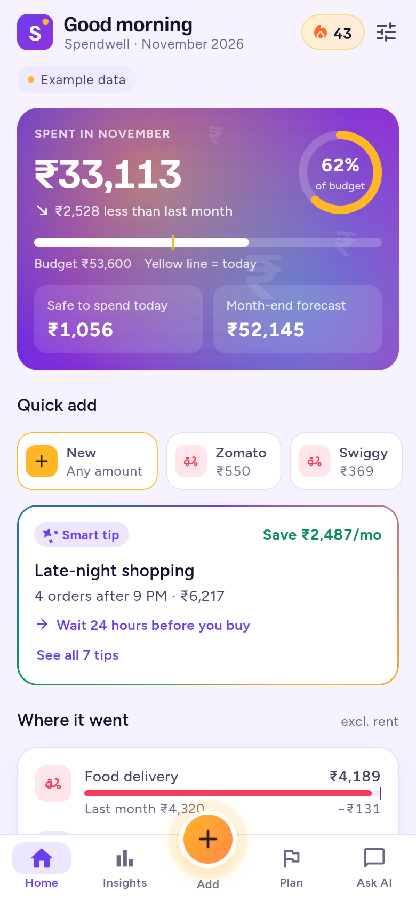
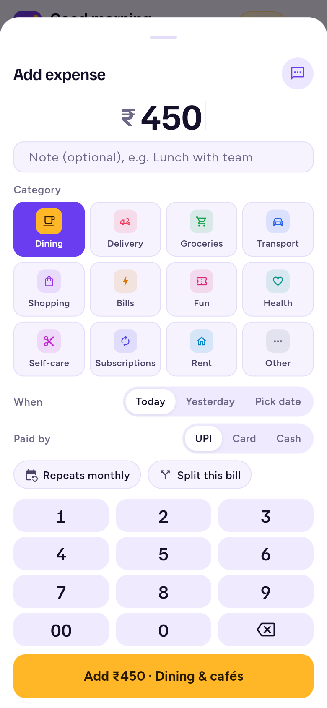
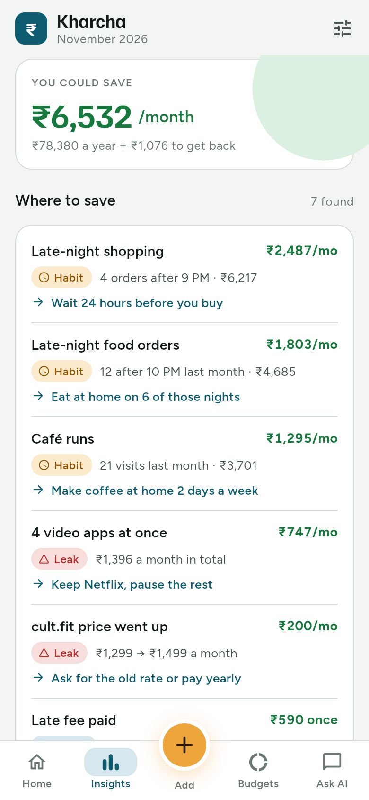
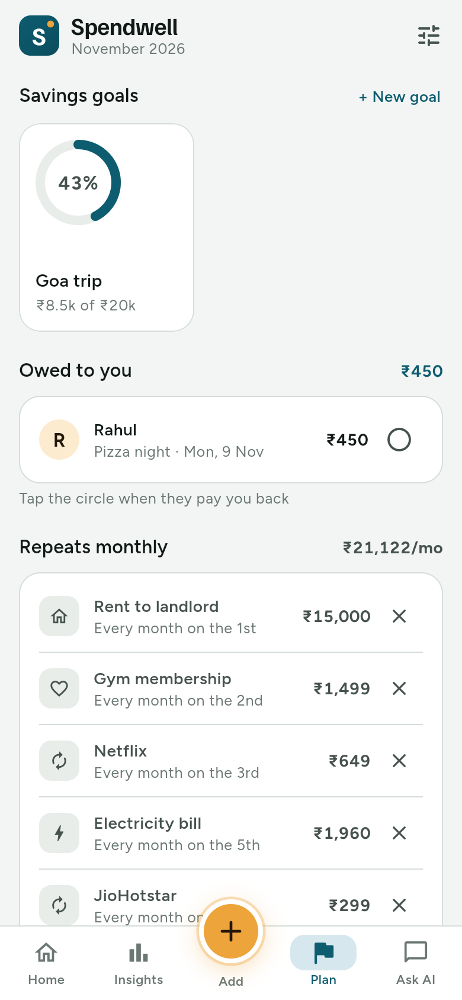
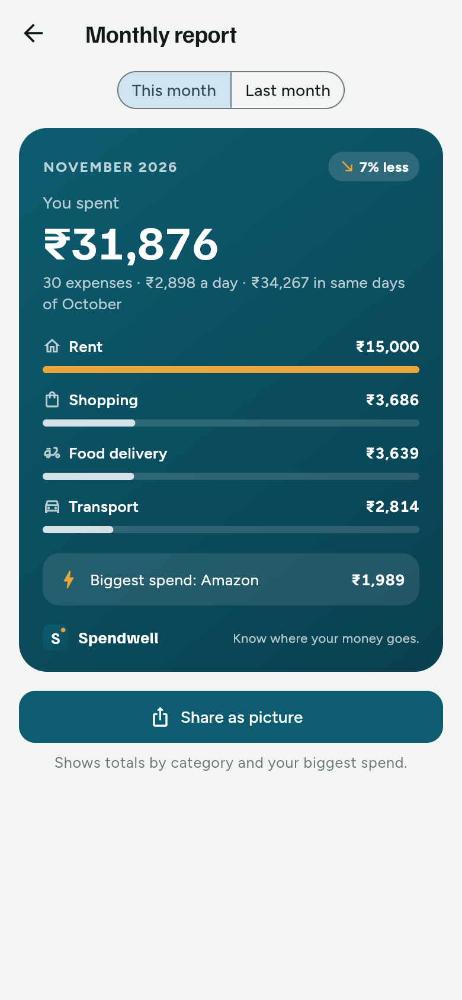

# Spendwell

An expense tracker for Android, iOS and the web. It shows where your money goes and finds specific ways to save, with an AI coach powered by Claude.

- **Try it in your browser:** https://semwal28.github.io/kharcha/
- **Android app:** download the APK from [Releases](https://github.com/semwal28/kharcha/releases/latest).

Built with Flutter (one codebase for Android, iOS and web) and Supabase (login, Postgres database, server functions).

<p>
  
  
  
  
  
</p>

## What works today

- **Add an expense in seconds:** keypad, note, category, date and payment method. Typing a note like "petrol" or "Swiggy" picks the category for you.
- **Your own categories:** pick **Other** and name it ("Gifts"). It becomes a category you can budget.
- **Quick add:** your usual spends from the last 30 days, one tap to repeat.
- **Home:** spent this month, budget used, safe to spend today, month-end forecast, the top saving tip, and recent expenses.
- **Insights:** money leaks and habits with the ₹ you'd save, plus a daily spending chart.
  - Leaks found include price rises, double charges, too many video apps, late-night orders, café runs and late fees.
- **AI savings plan and Ask AI chat:** Claude reads your month and answers in a few short lines.
- **Plan tab:**
  - **Savings goals** with progress rings. Add or take out money; a burst plays when you reach a goal.
  - **Owed to you:** bills you split with friends. Tick them off when they pay you back.
  - **Repeats monthly:** rent, gym, subscriptions. Added for you on the right day each month.
  - **Budgets:** per-category limits, "On track / Likely over / Over" status, and one-tap suggested budgets.
- **Budget alerts:** a banner drops in when an expense takes a category past 80% or 100% of its budget.
- **Split a bill:** in the add sheet, tap "Split this bill" and type names. You record your share; the rest goes to "Owed to you".
- **Paste a bank SMS:** copy a bank or UPI message, tap the message icon, and the amount, shop, date and payment type are filled in.
- **Scan a receipt (phones):** take or pick a photo; the total, shop and date are read on the phone (Google ML Kit). No photo leaves the phone.
- **Monthly report:** your month on one card. Share it as a picture.
- **Export:** Settings → Export as CSV (for spreadsheets) or PDF.
- **Any currency:** Settings → Currency. Picked from your region the first time. Changing it does not convert amounts you already entered.
- **App lock (phones):** fingerprint, face or phone PIN. Locks again after 30 seconds in the background.
- **Home screen widget (Android):** "Safe to spend today" at a glance. Long-press the home screen → Widgets → Spendwell.
- **Edit and delete:** tap any expense to edit it, change its category, add it again or delete it. Swipe left to delete, with Undo.
- **Light, Dark or Auto theme:** Settings → Appearance. The new theme spreads out in a circle from where you tap, and the choice is remembered.
- **Motion throughout:** a launch animation, shimmer loading screens, pull-to-refresh, an animated empty state, rolling numbers, rings and bars that draw themselves, and a success burst when you add an expense. All motion turns off when the phone's "reduce motion" setting is on.
- **Two ways to use it:**
  - **Without an account:** tap "Use without an account" on the sign-in screen (or build without Supabase keys). Everything is saved on the device. It starts with two months of example data; Settings → Start fresh clears it.
  - **With an account:** sign in with a 6-digit email code, and data syncs to Supabase. Settings has Sign out and Delete account (deletes everything, as Google Play requires).

## Project layout

```
lib/
  core/money.dart            ₹ formatting (Indian digit grouping), dates
  data/                      models, demo + Supabase repositories, example data
  domain/analysis.dart       totals, forecast, safe-to-spend, money-leak rules
  domain/category_guess.dart note → category
  domain/recurring.dart      monthly repeats, bill splits, budget alerts
  domain/text_parsers.dart   bank SMS and receipt text reading
  domain/report.dart         the monthly report
  services/                  export (CSV/PDF), receipt scanner, home widget
  data/local_repository.dart phone-only storage (no account needed)
  services/ai_coach.dart     calls the ai-coach server function
  state/app_state.dart       Riverpod state with instant (optimistic) updates
  ui/                        screens, theme, motion widgets
supabase/
  migrations/                database schema + row-level security
  functions/ai-coach/        server function that calls Claude
  functions/delete-account/  deletes an account and all its data
  tests/                     schema + security tests (plain Postgres)
android/app/src/main/kotlin/ home screen widget (Android)
scripts/deploy_backend.sh    one-command backend setup
docs/                        privacy policy, store listing, release checklist
test/                        unit + widget tests
.github/workflows/ci.yml     runs every check on each push
.github/workflows/pages.yml  publishes the web app to GitHub Pages
```

## Run it

You need the [Flutter SDK](https://docs.flutter.dev/get-started/install) (3.47 or newer).

Phone-only mode (no backend; starts with example data):

```bash
flutter pub get
```

```bash
flutter run
```

Tests:

```bash
flutter test
```

## Connect the real backend

You need a Supabase project, a Claude API key from [platform.claude.com](https://platform.claude.com), and the [Supabase CLI](https://supabase.com/docs/guides/cli).

```bash
export ANTHROPIC_API_KEY=your-key
```

```bash
scripts/deploy_backend.sh YOUR_PROJECT_REF
```

The script creates the tables and security rules, saves the Claude key as a server secret, and deploys both server functions. Then, in the Supabase dashboard:

- **Authentication → Email templates → Magic link:** make sure the template includes `{{ .Token }}`, so people get a code.
- **Authentication → Sign In / Providers → Email:** set **Email OTP Length** to **6**. The app expects a 6-digit code.

### Updating an existing project

If your project was set up before version 0.3.0, run the newer migration once: open **SQL Editor** in the Supabase dashboard, paste the contents of `supabase/migrations/20261111000000_goals_splits.sql`, and click **Run**. Until then, the app hides savings goals and bill splits and shows a short notice.

Run the app against it:

```bash
flutter run --dart-define=SUPABASE_URL=https://YOUR_PROJECT.supabase.co --dart-define=SUPABASE_PUBLISHABLE_KEY=sb_publishable_...
```

The AI uses `claude-opus-5-5` by default; set the `CLAUDE_MODEL` secret to change it. Daily AI limits per plan (free 10, pro 100, family 200) are at the top of `supabase/functions/ai-coach/index.ts`.

### Security

- Every table has row-level security, so a user can only read or change their own rows.
- Users cannot change their own plan.
- The Claude API key lives only on the server. The app never holds it.
- `supabase/tests/run_local.sh` checks these rules against a local Postgres.

## Release

Follow [docs/RELEASE.md](docs/RELEASE.md): signing key, app bundle, Google Play listing, then iOS. The privacy policy draft is in [docs/PRIVACY.md](docs/PRIVACY.md) and the store text in [docs/STORE_LISTING.md](docs/STORE_LISTING.md).

## Checks

Every push runs [CI](.github/workflows/ci.yml):
- app analysis and tests
- an Android APK build, downloadable from the run's artifacts
- the database security tests
- a type-check of the server functions

To run the database tests locally against a throwaway Postgres:

```bash
supabase/tests/run_local.sh
```

## Web app

The [Web app workflow](.github/workflows/pages.yml) builds the app on every push to `main` and publishes it to GitHub Pages. One-time setup: in the repository, open **Settings → Pages** and set **Source** to **GitHub Actions**, then re-run the workflow from the **Actions** tab.

It uses the repository variables `SUPABASE_URL`, `SUPABASE_PUBLISHABLE_KEY` and `AI_ENABLED` when they are set. Only the publishable key goes here, never the secret key.

On the web, receipt scan, app lock and the home screen widget are not available.

## Known limits

- **Bill splits** are tracked by you alone. Your friends don't get a copy yet (shared wallets are a later step).
- **Bank SMS** is copy and paste. Reading SMS automatically needs a permission Google Play allows only for a few app types.
- **Budget alerts** show while the app is open. Alerts when the app is closed need push notifications from a server.
- **Home screen widget** is Android only for now. iOS needs a widget extension built in Xcode.

## Next up

- Shared wallets for couples and flatmates
- Push notifications for budget alerts
- Voice entry and bank statement import
- Paid plans and payments

Fonts: Figtree and Familjen Grotesk, both under the SIL Open Font License.
