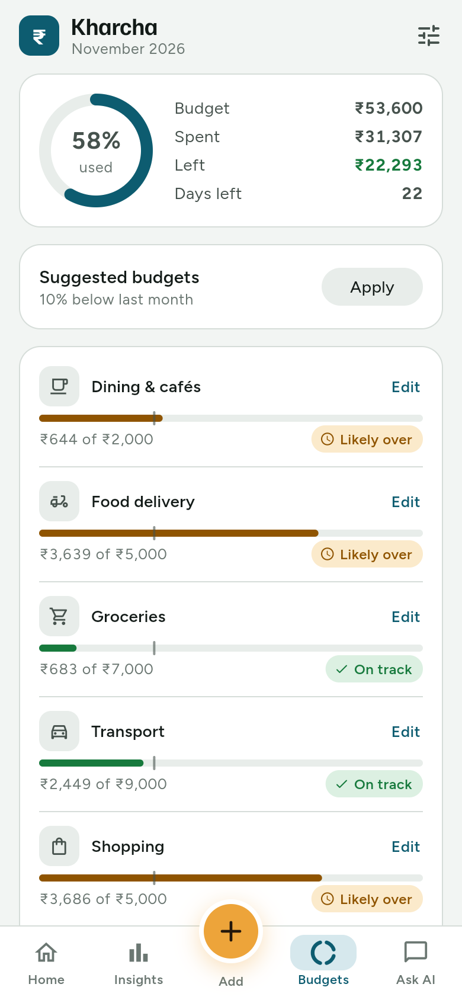

# Kharcha

An expense tracker for Android and iOS. It shows where your money goes and finds specific ways to save, with an AI coach powered by Claude.

Built with Flutter (one codebase for Android, iOS and web) and Supabase (login, Postgres database, server functions).

<p>
  
  
  
  
</p>

## What works today

- **Add an expense in seconds:** keypad, note, category, date and payment method. Typing a note like "petrol" or "Swiggy" picks the category for you.
- **Your own categories:** pick **Other** and name it ("Gifts"). It becomes a category you can budget.
- **Quick add:** your usual spends from the last 30 days, one tap to repeat.
- **Home:** spent this month, budget used, safe to spend today, month-end forecast, the top saving tip, and recent expenses.
- **Insights:** money leaks and habits with the ₹ you'd save, plus a daily spending chart.
  - Leaks found include price rises, double charges, too many video apps, late-night orders, café runs and late fees.
- **AI savings plan and Ask AI chat:** Claude reads your month and answers in a few short lines.
- **Budgets:** per-category limits, "On track / Likely over / Over" status, and one-tap suggested budgets.
- **Edit and delete:** tap any expense to edit it, change its category, add it again or delete it.
- **Motion throughout:** rolling numbers, rings and bars that draw themselves, and a success burst when you add an expense. All motion turns off when the phone's "reduce motion" setting is on.
- **Two ways to run:**
  - **On this phone (no account):** used when the app is built without Supabase keys. Everything is saved on the phone. It starts with two months of example data; Settings → Start fresh clears it.
  - **With an account:** sign in with an email code, and data syncs to Supabase. Settings has Sign out and Delete account (deletes everything, as Google Play requires).

## Project layout

```
lib/
  core/money.dart            ₹ formatting (Indian digit grouping), dates
  data/                      models, demo + Supabase repositories, example data
  domain/analysis.dart       totals, forecast, safe-to-spend, money-leak rules
  domain/category_guess.dart note → category
  data/local_repository.dart phone-only storage (no account needed)
  services/ai_coach.dart     calls the ai-coach server function
  state/app_state.dart       Riverpod state with instant (optimistic) updates
  ui/                        screens, theme, motion widgets
supabase/
  migrations/                database schema + row-level security
  functions/ai-coach/        server function that calls Claude
  functions/delete-account/  deletes an account and all its data
  tests/                     schema + security tests (plain Postgres)
scripts/deploy_backend.sh    one-command backend setup
docs/                        privacy policy, store listing, release checklist
test/                        unit + widget tests
.github/workflows/ci.yml     runs every check on each push
```

## Run it

You need the [Flutter SDK](https://docs.flutter.dev/get-started/install) (3.47 or newer).

Phone-only mode (no backend; starts with example data):

```bash
flutter pub get
```

```bash
flutter run
```

Tests:

```bash
flutter test
```

## Connect the real backend

You need a Supabase project, a Claude API key from [platform.claude.com](https://platform.claude.com), and the [Supabase CLI](https://supabase.com/docs/guides/cli).

```bash
export ANTHROPIC_API_KEY=your-key
```

```bash
scripts/deploy_backend.sh YOUR_PROJECT_REF
```

The script creates the tables and security rules, saves the Claude key as a server secret, and deploys both server functions. Then, in the Supabase dashboard, open **Authentication → Email templates → Magic link** and make sure the template includes `{{ .Token }}`, so people get a 6-digit code.

Run the app against it:

```bash
flutter run --dart-define=SUPABASE_URL=https://YOUR_PROJECT.supabase.co --dart-define=SUPABASE_PUBLISHABLE_KEY=sb_publishable_...
```

The AI uses `claude-opus-5-5` by default; set the `CLAUDE_MODEL` secret to change it. Daily AI limits per plan (free 10, pro 100, family 200) are at the top of `supabase/functions/ai-coach/index.ts`.

### Security

- Every table has row-level security, so a user can only read or change their own rows.
- Users cannot change their own plan.
- The Claude API key lives only on the server. The app never holds it.
- `supabase/tests/run_local.sh` checks these rules against a local Postgres.

## Release

Follow [docs/RELEASE.md](docs/RELEASE.md): signing key, app bundle, Google Play listing, then iOS. The privacy policy draft is in [docs/PRIVACY.md](docs/PRIVACY.md) and the store text in [docs/STORE_LISTING.md](docs/STORE_LISTING.md).

## Checks

Every push runs [CI](.github/workflows/ci.yml):
- app analysis and tests
- an Android APK build, downloadable from the run's artifacts
- the database security tests
- a type-check of the server functions

To run the database tests locally against a throwaway Postgres:

```bash
supabase/tests/run_local.sh
```

## Next up

- Voice entry, receipt scan, bank SMS and statement import
- Recurring expense detection from real data
- Paid plans and payments
- Push notifications for budget alerts

Fonts: Figtree and Familjen Grotesk, both under the SIL Open Font License.
